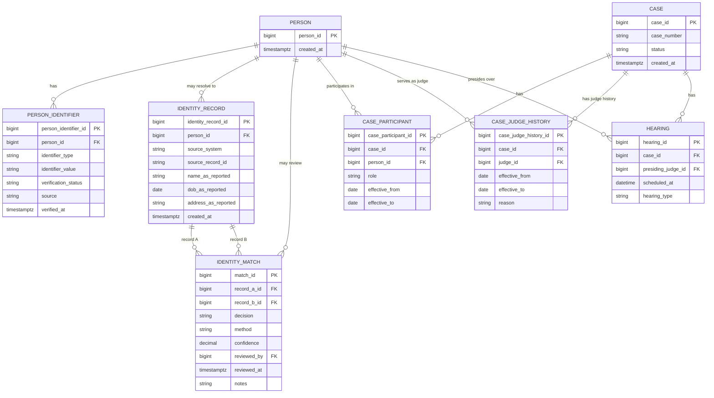
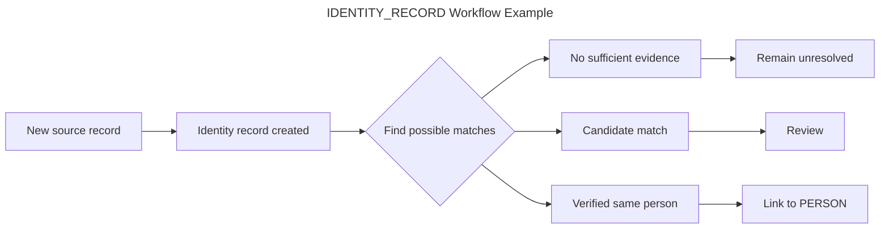
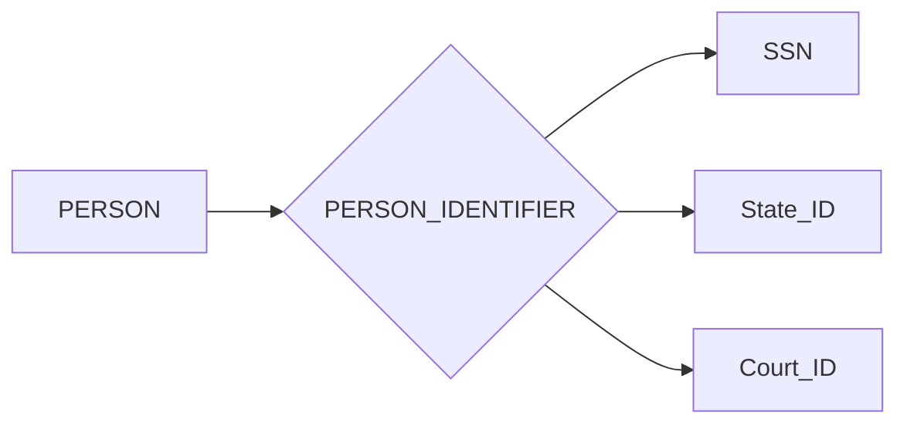
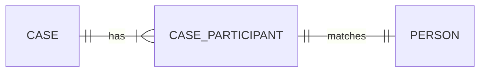

---
This document captures the reasoning behind the current domain model for a
court/case-management system. The goal is not to create a universal court
database schema, but to model the business rules identified while keeping
identity, participation, historical state, and system access separate.
---

## 1. Core design principle

The biggest principle behind the model is:

> **Do not make the database more certain than the evidence allows.**

A court system may receive conflicting or incomplete information from legacy
systems, clerks, external systems, or manual entry.

For example:

- `John Doe` appears in several historical records.
- A clerk later enters `Jon Doe`.
- The system cannot prove whether these are the same person.
- They could be the same person, a different person, a typo, a relative, or an
  alias.

Therefore the model separates:

1. what a source actually reported,
2. the canonical person identity the system maintains,
3. evidence/decisions about whether two records represent the same person,
4. the role that person has in a case,
5. the person's authorization to use the application.

This prevents uncertain identity matching from becoming an irreversible data
destruction problem.

---

## 2. High-level ERD


## 3. Why `PERSON` is not in the IDENTITY_RECORD
`PERSON` represents the system's canonical identity. As such it does **not** represent every spelling of a person's name found in every source system.

For example:
```
PERSON #8472

IDENTITY_RECORD #100
    source = LegacyCMS
    name_as_reported = "John Doe"

IDENTITY_RECORD #391
    source = JailSystem
    name_as_reported = "Jon Doe"
```
If the evidence eventually establishes that both records represent the same individual, both identity records can then point to `PERSON #8472`.

The raw values will remain intact, which is important because changing `"Jon Doe"` into `"John Doe"` destroys the historical fact that the system actually reported `"Jon Doe"`. The canonical person and the source record answer different questions:
* PERSON: Who does our system believe this identity represents?
* IDENTITY_RECORD: What did this particular source actually tell us?

## 4. Why `IDENTITY_RECORD.person_id` is nullable
A newly imported or manually entered identity may not be resolved to start off, therefore:
```
IDENTITY_RECORD
    person_id = null
```
is a valid state.

The workflow can be:

This is preferable to forcing every incoming record into a canonical person
immediately.

## 5. Why `IDENTITY_MATCH` exists
The system needs to record **why** two identity records were considered the same or different. A matching service might notice:
```
John Doe
Jon Doe
DOB: same
Address: same
```
and generate a candidate. However, the similarity is not automatically proof. A human reviewer might determine: `SAME_PERSON` or `NOT_SAME_PERSON`, and it is that decision that should be represented explicitly.

`IDENTITY_MATCH` therefore captures concepts such as:
* which records were compared,
* what decision was reached,
* how the match was produced,
* confidence level (when applicable),
* who reviewed it,
* when it was reviewed
* supporting notes.

**Negative decisions are useful information as well**. If the system repeatedly sees two people with similar names and determines that they are different people, retaining that decision can help prevent the same false match from repeatedly surfacing.

## 6. Deterministic versus probabilistic identity matching
Not all identity evidence has the same strength. A useful conceptual distinction is:
### Strong deterministic evidence
Example:
```
Verified unique identifier = same
```
Can provide strong evidence that two records refer to the same person, assuming that the identifier itself was collected and verified correctly.

### Probabilistic evidence
Examples:
```
Similar name
Same date of birth
Similar address
Same employer
Similar demographic information
```
These can produce a candidate match BUT do not necessarily prove identity. The system should distinguish `"records look similar"` from `"We have sufficient evidence that these records represent the same person."`

The ERD supports both automated matching and human review without forcing the matching algorithm to become the source of truth.

from pathlib import Path

md = r'''# Court / Case Management Domain Model

This document captures the reasoning behind the current domain model for a
court/case-management system. The goal is not to create a universal court
database schema, but to model the business rules we identified while keeping
identity, participation, historical state, and system access separate.


## 7. Why unique identifiers are not the `PERSON` primary key

A natural temptation is:
```
PERSON
    SSN PK
```
That is intentionally avoided. A person's canonical database identity should be represented by an internal surrogate key such as `person_id`. Identifiers such as SSN, state ID, or court-specific IDs belong in `PERSON_IDENTIFIER`.

Reasons include:
* not every person will have every identifier,
* identifiers can come from different sources,
* identifiers may require verification,
* different systems may use different identifiers,
* identifiers are sensitive data,
* an identifier's validity is a business concern separate from database identity.

Conceptually:

The exact identifier types and storage/security strategy would depend on the
actual system requirements.

## 8. Why `CASE_PARTICIPANT` exists
I originally considered modeling attorneys, defendants, guardians, and judges as separate direct relationships from `CASE`. I realized that becomes difficult when participation changes over time.

A case may have:
* multiple attorneys,
* different attorneys at different times,
* multiple defendants,
* guardians,
* other participants,
* a judge whose involvement changes over the lifetime of the case.

Therefore the model introduces:

with attributes such as:
* role
* effective_from
* effective_to

This turns the relationship itself into an entity. For example:
```
CASE #123
    |
    +-- PERSON #10
    |     role = ATTORNEY
    |     effective_from = 2026-01-01
    |
    +-- PERSON #20
          role = DEFENDANT
```
The important point is that the relationship is not just: `Person belongs to Case`, It is:
```
Person participates in Case
    - in a particular role
    - during a particular period
```
## 9. Why `CASE_PARTICIPANT` does not automatically mean system access
Being involved in a case doesn't mean someone can log into the case-management system. For example:
* A defendant may be associated with a case but have no CMS account.
* An attorney may be associated with many cases but use a separate external system.
* A judge may participate in cases and also have CMS permissions.
* A clerk may have CMS access without being a participant in a particular case.

Therefore these concepts should remain separate:
```
PERSON
   |
   +---- CASE_PARTICIPANT
   |
   +---- SYSTEM_USER / ACCOUNT
```
and authorization can be modeled separately from both. This prevents a common modeling mistake:
> assuming a business relationship automatically implies an authentication or authorization relationship.

## 10. Why judges are special
Judges introduced an important distinction.

A case may have an official judge, but a different judge may preside over a
specific hearing because the assigned judge is unavailable.

Those are two different business facts.

### Case judge
The case's official judge assignment answers:
> Who is officially assigned to this case during this period?

### Presiding judge

The hearing answers:

> Who actually presided over this particular event?

Therefore:
```
CASE
   |
   +---- CASE_JUDGE_HISTORY
              |
              +---- PERSON
```
and:
```
HEARING
   |
   +---- presiding_judge_id ---> PERSON
```
This avoids trying to force two different concepts into one relationship.

## 11. Why `CASE_JUDGE_HISTORY` exists
Initially, a single `CASE.judge_id` looks sufficient. It is sufficient only if historical changes do not matter. However, I made the assumption that a case may outlast a judge's elected term. For example:
```
2024 ---------------- 2027
Judge A

2027 ---------------- 2030
Judge B
```
The current judge alone cannot answer:
> Who was the judge assigned to this case in 2025?

Therefore the assignment becomes historical data:
```
CASE_JUDGE_HISTORY
    case_id
    judge_id
    effective_from
    effective_to
    reason
```
This is another example of a relationship becoming an entity because the
relationship itself has attributes and history.

## 12. Why hearings directly reference a judge
I considered a generic assignment table for substitute judges, which would be useful if the business rule were:
> A judge is assigned to a case for a period of time.

But going from experience, the substitution scenario is more specific:
> A different judge may handle a particular hearing, trial, or other event.

That makes the event itself the natural place to record the acting judge. Therefore:
```
HEARING
    presiding_judge_id
```
can answer:
```
Case 123
Hearing: March 4
Presiding judge: Judge B
Official case judge: Judge A
```
Both facts can coexist without ambiguity.

## 13. The difference between case assignment and event participation

This distinction is one of the most important decisions in the model. Consider:
```
CASE
    official judge = Judge A

HEARING #1
    presiding judge = Judge A

HEARING #2
    presiding judge = Judge B

HEARING #3
    presiding judge = Judge A
```
The case's official assignment did not necessarily change. Judge B simply acted for a particular event. If we instead changed `CASE_JUDGE_HISTORY` every time a substitute judge handled a hearing, we would be mixing two separate business concepts. So:
* Case judge history tracks official assignment.
* Hearing presiding judge tracks event-level responsibility.

## 14. Attorneys, defendants, guardians, and other roles
I deliberately avoided assuming that every person should become a specialized
database entity such as:
```
ATTORNEY
DEFENDANT
GUARDIAN
JUDGE
```
simply because those are business roles. The same person can have different roles over time.For example:
```
PERSON #50

2020-2026
    ATTORNEY

2026-2034
    JUDGE

2034+
    ATTORNEY
```
The person's identity did not change, their role changed. Therefore the model conceptually separates:
```
PERSON
   |
   +---- role / professional status
   |
   +---- case participation
   |
   +---- system access
```
A more detailed implementation could introduce PERSON_ROLE or specialized
role tables if the role itself eventually requires substantial attributes.

For example, if judges require court, district, election term, appointment
information, etc., that may justify a dedicated judge-related entity. The important design rule is:
> Do not create separate identities just because one person can occupy multiple roles.

## 15. Identity versus role versus participation
These four concepts should remain distinct.

### Identity
`PERSON` answers:
> Who is this individual?

### Role
Potentially `PERSON_ROLE` answers:
> What professional or organizational role does this person hold?

### Participation
`CASE_PARTICIPANT` answers:
> What role does this person play in this particular case?

### System access
Potentially:
```
USER_ACCOUNT
ROLE
PERMISSION
```
Answers:
> What is this person allowed to do in this application?

Those questions are related, but they are not the same question.

## 16. Example end-to-end scenario

Suppose a legacy system sends:
```
Name: John Doe
DOB: 1995-04-12
Source: LegacyCMS
Record: 12345
```
The integration layer creates:
```
IDENTITY_RECORD #100
    person_id = NULL
    name_as_reported = "John Doe"
```
The system finds:
```
PERSON #8472

IDENTITY_RECORD #391
    name_as_reported = "John Doe"
```
with supporting evidence.

The matching process creates:
```
IDENTITY_MATCH
    record_a = #100
    record_b = #391
    decision = PENDING_REVIEW
    method = FUZZY_MATCH
    confidence = 0.96
```
A reviewer verifies the match.

Then:
```
IDENTITY_MATCH
    decision = SAME_PERSON
    reviewed_by = <reviewer>
```
and:
```
IDENTITY_RECORD #100
    person_id = 8472
```
Now the new case can use:
```
CASE_PARTICIPANT
    case_id = 500
    person_id = 8472
    role = DEFENDANT
```
The historical source data still says exactly what the source reported.

## 17. What happens when the records are different people?

Suppose the system finds:
```
John Doe
Jon Doe
```
but the reviewer determines they are father and son. We should not merge them just because their names are similar.

Instead:
```
IDENTITY_RECORD #100
    person_id = 8472

IDENTITY_RECORD #391
    person_id = 9211
```
and:
```
IDENTITY_MATCH
    record_a = #100
    record_b = #391
    decision = NOT_SAME_PERSON
```
The system now has explicit evidence that these records should not be treated as the same identity.

## 18. Constraints that belong in the database
The application should enforce business rules where practical, but the
database should still protect core integrity. Examples:
```
IDENTITY_RECORD
    UNIQUE(source_system, source_record_id)
```
This prevents importing the exact same source record twice. Foreign keys should protect relationships such as:
```
CASE_PARTICIPANT.person_id -> PERSON.person_id

CASE_PARTICIPANT.case_id -> CASE.case_id

HEARING.case_id -> CASE.case_id

HEARING.presiding_judge_id -> PERSON.person_id
```
For historical relationships, additional constraints should eventually prevent overlapping effective periods where the business rule says only one assignment can exist at a time.

For example, if exactly one official judge must exist for a case at any point in time, overlapping judge-history periods should be prohibited.

The exact PostgreSQL implementation can use exclusion constraints, unique indexes, triggers, or application-level validation depending on the final requirements.

## 19. What this model intentionally does NOT decide yet
There are several areas where the domain model needs more business requirements before the schema should become more specific.

### User accounts and authorization
We know that system access is separate from case participation, but the exact
authorization model has not been defined. Potential concepts include:
```
USER_ACCOUNT
SYSTEM_ROLE
PERMISSION
USER_ROLE
```
but these should be driven by actual requirements. Detailed judge employment/appointment history We know judge assignments can change. We have not yet established the full domain model for:
* courts,
* districts,
* election terms,
* appointments,
* vacancies,
* judicial divisions,
* court-specific roles.

Those should not be invented prematurely.

### Attorney-specific information
If attorneys require attributes beyond generic person/role information, a
specialized attorney entity may eventually be justified.

### Identity matching algorithms
The ERD stores matching decisions and evidence. It does not prescribe one particular matching algorithm. The matching service could evolve independently of the core domain model.

## 20. The resulting mental model

The entire design can be reduced to five questions:
```
1. Who is this?
       |
       v
    PERSON

2. What did the source actually report?
       |
       v
    IDENTITY_RECORD

3. What do we know about whether two records represent the same person?
       |
       v
    IDENTITY_MATCH

4. What is this person doing in this case?
       |
       v
    CASE_PARTICIPANT

5. What actually happened during a particular court event?
       |
       v
    HEARING / other event entities
```
Judge history is then treated as a specialized historical relationship:
```
CASE
  |
  +-- CASE_JUDGE_HISTORY
```
while event-level judicial responsibility remains:
```
HEARING
  |
  +-- presiding_judge_id
```