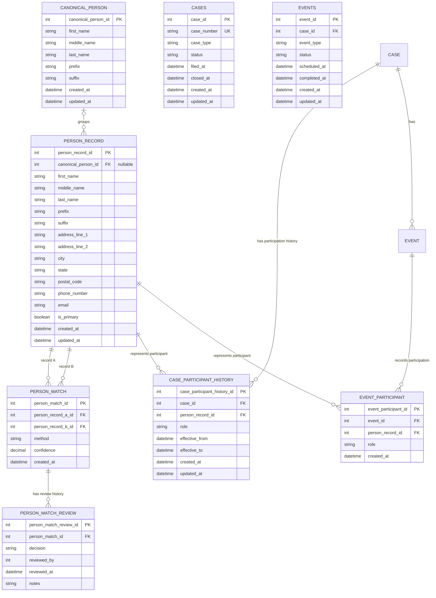

# Court Case Management System — Domain Model

## 1. Purpose and Scope

This document describes the domain model for a court case-management system (CMS).

The goal is not to create a universal court database schema. The goal is to model identified business rules in a way that preserves important facts, supports reporting, and allows the system to evolve without unnecessary complexity.

The model separates:

- Canonical person identity from individual person records.
- Identity-resolution evaluations from the decisions made about them.
- Case participation from event participation.
- Current state from historical facts where history is required.
- Domain relationships from application authorization and access.

The initial version intentionally limits its scope. Features are introduced when a known business rule requires them, rather than to accommodate every hypothetical court workflow.

## 2. Design Principles

### Preserve what the system knows

**Do not make the database more certain than the evidence allows.**

Similar names, addresses, or other attributes do not prove that two records represent the same person. The system must preserve individual records and distinguish evidence of identity from confirmed identity.

### Preserve meaningful history

When a fact changes, consider whether the previous value remains important for reporting or reconstructing what happened. Historical facts should not be silently overwritten when the business requires them to remain available.

### Keep responsibilities separate

A person, a person record, a case participation, and an event participation represent different concepts. They should not be collapsed into one entity simply because they refer to the same individual.

### Design for reporting without shaping the entire database around reports

Core tables represent domain facts. Views and reporting queries can combine those facts for specific reporting needs without forcing the underlying model into a report-shaped structure.

### Prefer justified complexity

The initial model should implement known requirements. More elaborate workflows, configurable subsystems, and jurisdiction-specific variations can be introduced when actual requirements justify them.

## 3. Entity Relationship Diagram

The diagram illustrates the core entities and relationships. It does not represent every business rule or database constraint.

In particular:

- A person record may exist without an established canonical identity.
- Case and event participation reference person records. Canonical identity is derived through `PERSON_RECORD`.
- `PERSON_MATCH` identifies a pair of records being evaluated. `PERSON_MATCH_REVIEW` preserves individual decisions over time.
- Official case judge assignments are represented through `CASE_PARTICIPANT_HISTORY`.
- Event-specific judicial involvement, including substitutes, is represented through `EVENT_PARTICIPANT`.

## 4. Person and Identity Domain

### 4.1 `CANONICAL_PERSON`

**Purpose:** Represents the system's canonical identity for a real-world person.

A canonical person groups person records that have been determined to represent the same individual. It provides the primary person destination in the application without erasing the individual records that contributed to that identity.

Proposed attributes:

| Attribute                  | Purpose                                      |
| -------------------------- | -------------------------------------------- |
| `canonical_person_id` (PK) | Internal identifier for the canonical person |
| `first_name`               | Canonical first name                         |
| `middle_name`              | Canonical middle name, if known              |
| `last_name`                | Canonical last name                          |
| `prefix`                   | Name prefix, if applicable                   |
| `suffix`                   | Name suffix, if applicable                   |
| `created_at`               | Creation timestamp                           |
| `updated_at`               | Last update timestamp                        |

Canonical attributes represent facts established by the CMS and may differ from the values preserved in individual person records.

Changing a canonical name must not automatically overwrite person-record names. A person record may be corrected when its own data is found to be erroneous, but that correction is distinct from changing the canonical identity.

### 4.2 `PERSON_RECORD`

**Purpose:** Represents a persistent representation of a person as entered into the CMS.

A person record preserves the attributes recorded for that representation. It is not a separate record for every case in which the person participates.

Proposed attributes:

| Attribute                            | Purpose                                                            |
| ------------------------------------ | ------------------------------------------------------------------ |
| `person_record_id` (PK)              | Unique identifier for the person record                            |
| `canonical_person_id` (FK, nullable) | Associated canonical person, if established                        |
| `first_name`                         | First name as recorded                                             |
| `middle_name`                        | Middle name as recorded, if available                              |
| `last_name`                          | Last name as recorded                                              |
| `prefix`                             | Name prefix, if applicable                                         |
| `suffix`                             | Name suffix, if applicable                                         |
| `address_line_1`                     | Primary address line                                               |
| `address_line_2`                     | Secondary address line, if applicable                              |
| `city`                               | City                                                               |
| `state`                              | State                                                              |
| `postal_code`                        | Postal or ZIP code                                                 |
| `phone_number`                       | Phone number, if available                                         |
| `email`                              | Email address, if available                                        |
| `is_primary`                         | Whether this is the default person record for the canonical person |
| `created_at`                         | Creation timestamp                                                 |
| `updated_at`                         | Last update timestamp                                              |

For Phase I, person records are created by this CMS. External source-system integration and its associated source identifiers are outside the current scope.

A person record's primary key identifies the record. Names and addresses are not unique identifiers; two records with identical attributes may legitimately represent different individuals.

#### Primary person record

`is_primary` identifies the default person record to select when a user chooses a canonical person for a new case association.

It does not mean that the record is universally more accurate or authoritative than every other record. Different records may contain different information.

Changing the primary record affects future default selections. It does not rewrite existing case participation or automatically propagate information to other records.

The implementation must enforce that no more than one person record is primary for a canonical person. Whether a canonical person may temporarily have no primary record remains an implementation decision.

An unresolved person record cannot be the primary record of a canonical person until it has been associated with one.

### 4.3 `PERSON_MATCH`

**Purpose:** Represents an identity-resolution evaluation between two person records.

This entity identifies the pair of records being evaluated and preserves information about how the potential match was identified.

Proposed attributes:

| Attribute                 | Purpose                                     |
| ------------------------- | ------------------------------------------- |
| `person_match_id` (PK)    | Unique identifier for the match evaluation  |
| `person_record_a_id` (FK) | First person record                         |
| `person_record_b_id` (FK) | Second person record                        |
| `method`                  | Method used to identify the potential match |
| `confidence`              | Confidence score, if produced               |
| `created_at`              | Creation timestamp                          |

A matching algorithm may identify potential matches, but similarity is not itself proof of identity. The application or client policy determines whether a match requires review or can be accepted automatically.

The model must not assume that a particular confidence threshold is universally appropriate for automatic association.

The implementation must prevent a person record from being matched against itself and should prevent duplicate evaluations of the same unordered pair of records.

For example, the pair `(1042, 1051)` should not be represented as two separate candidates merely because the record order was reversed.

### 4.4 `PERSON_MATCH_REVIEW`

**Purpose:** Preserves each review decision associated with a person-match evaluation.

A match evaluation may be reviewed more than once as new evidence becomes available. Each review is recorded separately rather than overwriting the prior decision.

Proposed attributes:

| Attribute                     | Purpose                                    |
| ----------------------------- | ------------------------------------------ |
| `person_match_review_id` (PK) | Unique identifier for the review record    |
| `person_match_id` (FK)        | Associated match evaluation                |
| `decision`                    | Decision reached during the review         |
| `reviewed_by`                 | Reviewer identifier, if applicable         |
| `reviewed_at`                 | Review timestamp                           |
| `notes`                       | Supporting explanation or evidence summary |

Possible review decisions include:

- `SAME_PERSON`
- `NOT_SAME_PERSON`
- `INCONCLUSIVE`

A match with no review record is awaiting review. This avoids treating a workflow state such as `PENDING_REVIEW` as a completed review decision.

The latest review determines the current recorded decision, while earlier reviews remain available for audit and historical interpretation.

For example, a match may initially be rejected and later reconsidered after new evidence emerges. The system records the subsequent decision without deleting the original rejection.

The absence of a review record means no review decision has been recorded; it does not establish that the two records represent different people.

`reviewed_by` is not yet connected to a modeled user-account entity. Its representation and relationship to future authorization tables will be determined when that domain is designed.

### 4.5 Identity-resolution workflow

A person record can exist without a canonical person association.

A typical workflow is:

1. Create a person record.
2. Identify potential matches with existing records.
3. Create a match evaluation for a candidate pair.
4. Review the available evidence when required.
5. Record each review decision in `PERSON_MATCH_REVIEW`.
6. Associate the person record with a canonical person when the identity relationship is established.

The original person records remain intact. Establishing a shared canonical identity does not require deleting or merging those records.

Identity-resolution decisions and canonical-person associations are related but distinct. A match decision records the evaluation of a pair of records; the association to a canonical person represents the identity relationship currently established by the CMS.

## 5. Case Domain

### 5.1 `CASE`

**Purpose:** Represents a court case maintained by the CMS.

Proposed attributes:

| Attribute          | Purpose                          |
| ------------------ | -------------------------------- |
| `case_id` (PK)     | Internal case identifier         |
| `case_number` (UK) | Business identifier for the case |
| `case_type`        | Type or classification of case   |
| `status`           | Current case status              |
| `filed_at`         | Filing timestamp                 |
| `closed_at`        | Closure timestamp, if applicable |
| `created_at`       | Creation timestamp               |
| `updated_at`       | Last update timestamp            |

`case_id` is the database primary key. `case_number` is the business identifier and is unique within the scope defined for this model.

Phase I assumes that a case number incorporates the filing year, sequence number, and case type. For example, a number may follow the format `2006-12345-CIVIL`.

This model also assumes that a given case type is handled by only one court within the operating scope. Under that assumption, `case_number` can serve as the unique business identifier without introducing a court entity solely to qualify the number.

This is an explicit scope assumption, not a claim that all court systems follow this convention. If the system later needs to represent multiple courts that can issue colliding case numbers for the same case type, the uniqueness rule must be revisited.

The initial model treats `case_type` as an attribute rather than introducing a configurable case-type subsystem. Jurisdiction-specific type definitions and workflow configuration are outside Phase I.

### 5.2 Case status

Phase I stores the current status on `CASE`.

Historical status transitions are a potential future requirement. If reporting needs to reconstruct status changes, measure time spent in each status, or distinguish initial closure from reopening, a dedicated `CASE_STATUS_HISTORY` entity may be justified.

That future entity could record the case, status, effective timestamp, and reason for the change.

A separate status lookup table is not required merely because the set of statuses is finite. It becomes useful if statuses require their own metadata, effective dates, reporting categories, or transition rules.

The implementation must define the allowed Phase I case statuses and clarify how those statuses relate to `closed_at`.

## 6. Case Participation

### 6.1 Definition of a case participant

A **case participant is any person formally associated with a case through a defined case-level role**.

This includes defendants, attorneys, guardians, and the officially assigned judge. The term is not limited to parties or individuals who appear at a particular proceeding.

### 6.2 `CASE_PARTICIPANT_HISTORY`

**Purpose:** Records who was formally associated with a case, in what capacity, and during what period.

Proposed attributes:

| Attribute                          | Purpose                                        |
| ---------------------------------- | ---------------------------------------------- |
| `case_participant_history_id` (PK) | Unique identifier for the participation period |
| `case_id` (FK)                     | Associated case                                |
| `person_record_id` (FK)            | Person record used for the association         |
| `role`                             | Formal role in the case                        |
| `effective_from`                   | Start of the participation period              |
| `effective_to`                     | End of the participation period, if recorded   |
| `created_at`                       | Creation timestamp                             |
| `updated_at`                       | Last update timestamp                          |

A person record can be associated with multiple cases. A case can have multiple participants, and participants may change over time.

For example, when an attorney leaves a case and another attorney takes over, the former participation period is retained and a new participation period is recorded.

The current participant list is derived from participation records and their effective periods. For a current-date query, the record must have started by the date being queried and must not have ended before that date.

A null `effective_to` means that no end has been recorded. It does not independently prove that a participation is active now, because a participation may be future-dated.

#### Participation-period convention

Phase I treats `effective_to` as an inclusive boundary: participation remains effective through the specified end date or timestamp.

A participation may begin and end on the same date or timestamp. The implementation must use a consistent temporal precision and comparison convention.

If participation is tracked at date-level granularity, an end date represents the entire calendar day. If exact times matter, timestamp precision and inclusive boundary semantics must be defined explicitly rather than approximated using an arbitrary end-of-day time.

The chosen convention must be applied consistently to current-participant queries, historical reports, and overlap checks.

### 6.3 Official judge assignments

Official case judge assignments are represented through `CASE_PARTICIPANT_HISTORY`. A separate `CASE_JUDGE_HISTORY` table is not part of this model.

The official judge is a case-level role, not a separate kind of person or relationship.

The model must preserve assignment periods and enforce the business rule that a case has no more than one official judge assigned at a time.

The role definition must distinguish the official case judge assignment from other forms of judicial involvement.

A judge who temporarily presides over a proceeding does not become the official case judge merely by participating in that event.

#### Assignment integrity

A new official judge assignment must be rejected if its effective period overlaps the effective period of another official judge assignment for the same case.

The overlap check must consider the full proposed effective period, including historical and future-dated assignments, rather than checking only for an existing participant whose end date is null.

The implementation must also account for concurrent assignment requests so two overlapping assignments cannot both pass validation before either is saved.

The specific database and application mechanisms used to enforce these rules will be determined during implementation.

## 7. Court Events

### 7.1 Event boundary

An event represents a scheduled court proceeding or activity associated with a case, such as a hearing, trial, or pretrial examination.

This model concerns court proceedings, not every event in a person's interaction with the justice system. Arrests, detention, and jail placement or movement belong to separate operational domains.

### 7.2 `EVENT`

**Purpose:** Records a court proceeding or activity associated with a case.

Proposed attributes:

| Attribute       | Purpose                                   |
| --------------- | ----------------------------------------- |
| `event_id` (PK) | Unique identifier for the event           |
| `case_id` (FK)  | Associated case                           |
| `event_type`    | Type of proceeding or activity            |
| `status`        | Current event status                      |
| `scheduled_at`  | Scheduled date and time                   |
| `completed_at`  | Actual completion timestamp, if completed |
| `created_at`    | Creation timestamp                        |
| `updated_at`    | Last update timestamp                     |

Phase I uses the following event statuses:

- `SCHEDULED`
- `CANCELLED`
- `COMPLETED`

Their meanings are:

- **`SCHEDULED`:** The event is scheduled and has not been recorded as completed or cancelled.
- **`CANCELLED`:** The scheduled occurrence did not take place.
- **`COMPLETED`:** The proceeding or activity actually occurred and concluded.

The scheduled timestamp represents the planned occurrence. The completion timestamp represents actual completion and is null until that fact is recorded.

The model permits an event to be entered after it occurred, including an event initially recorded as completed with its actual completion timestamp.

### 7.3 Event integrity rules

The database should enforce these state-consistency rules:

| Status      | `completed_at`   |
| ----------- | ---------------- |
| `SCHEDULED` | Must be null     |
| `CANCELLED` | Must be null     |
| `COMPLETED` | Must not be null |

The status must also be constrained to the allowed Phase I values.

These constraints validate the resulting record state. They do not define every permitted transition between statuses.

Each scheduled occurrence is represented by its own event record. If an occurrence is cancelled and another is scheduled, the cancelled record remains and the new occurrence receives a new record. Explicit rescheduling relationships and scheduling workflows are deferred.

`event_type` remains a simple attribute in Phase I. A configurable event-type subsystem is not required at this stage, though the implementation must maintain consistent values for reliable reporting.

## 8. Event Participation

### 8.1 `EVENT_PARTICIPANT`

**Purpose:** Records a person's involvement in a particular court event and their event-specific role.

Proposed attributes:

| Attribute                   | Purpose                                 |
| --------------------------- | --------------------------------------- |
| `event_participant_id` (PK) | Unique identifier for the participation |
| `event_id` (FK)             | Associated event                        |
| `person_record_id` (FK)     | Person record used for the association  |
| `role`                      | Role in the event                       |
| `created_at`                | Creation timestamp                      |

Event participation is independent of case participation.

A person may participate in an event without being a formal case participant. For example, a substitute judge, magistrate, or witness may be recorded for a specific proceeding without becoming a formal case-level participant.

Likewise, a case participant does not necessarily participate in every event associated with that case.

The event role describes the person's involvement in that proceeding. It should not be inferred automatically from the person's case-level role.

As with case participation, canonical identity is derived through `PERSON_RECORD`. An unresolved person record can be associated with an event without first establishing a canonical identity.

### 8.2 Presiding judges and substitutes

The event model does not require every event to have a judge-specific foreign key. Different proceedings may involve different judicial roles, including magistrates.

Instead, event-specific roles are recorded through `EVENT_PARTICIPANT`. A presiding judge is represented as an event participant with the appropriate role.

For example:

- Judge A is the official judge assigned to Case 123.
- Judge B presides over a hearing because Judge A is unavailable.
- `CASE_PARTICIPANT_HISTORY` preserves Judge A's official assignment.
- `EVENT_PARTICIPANT` records Judge B's participation in the hearing.

The event record does not change the official case assignment.

Phase I records which people participated and their event roles. It does not track the precise timing of role changes within a single event. It also does not enforce that exactly one presiding judge must be recorded for every event.

This allows the model to record actual event participation without forcing every proceeding to have a particular judicial role.

## 9. Identity References Across Participation

Case and event participation reference a person record, allowing participation to be recorded even when a canonical identity has not been established.

The relationship between a person record and its canonical person is maintained in `PERSON_RECORD`. Participation tables do not duplicate `canonical_person_id`.

When the canonical identity of a person record is established or changed, queries that follow the relationship through `PERSON_RECORD` reflect that association. The participation record itself does not preserve a separate historical snapshot of the canonical identity.

This is an intentional Phase I trade-off: the model keeps a single source of truth for the person-record-to-canonical-person association and avoids contradictory identity references in participation records.

The original person records and participation history remain intact when a canonical association is established. This does not imply automatic propagation of corrections or attributes across person records.

## 10. Reporting and Historical Interpretation

Reporting is a first-class concern, but reporting requirements should not dictate the shape of every core table.

The domain model preserves the facts from which reports can be constructed.

| Reporting question                                    | Relevant domain fact                                    |
| ----------------------------------------------------- | ------------------------------------------------------- |
| Who is the official judge assigned to a case now?     | Current case participation with the official judge role |
| Who was the official judge during a given period?     | Effective dates in `CASE_PARTICIPANT_HISTORY`           |
| Who presided over a particular hearing?               | `EVENT_PARTICIPANT`                                     |
| Who participated in a case when it closed?            | Case participation history and the case closure time    |
| What is the case's current status?                    | `CASE.status`                                           |
| How did the case status change over time?             | Future status history, if required                      |
| What was the latest recorded identity-match decision? | The latest `PERSON_MATCH_REVIEW` for the match          |
| What identity-match decisions were made previously?   | All associated `PERSON_MATCH_REVIEW` records            |

Views and reporting queries can combine these facts into the format needed by a particular report.

Historical queries must use the applicable timestamps and effective-date semantics rather than assuming that the current record state describes the past.

The model intentionally distinguishes historical participation from historical identity association. It preserves who was associated with a case through a particular person record, but it does not independently preserve every historical change to that record's canonical identity association.

## 11. Application Access Is a Separate Concern

A person's existence in the domain does not imply that the person can log into the CMS.

Case participation and event participation describe domain relationships. They do not grant permissions.

A future authorization model may include concepts such as:

- `USER_ACCOUNT`
- `SYSTEM_ROLE`
- `PERMISSION`
- `USER_ROLE`

These concepts are separate from person identity and case participation. A defendant may have no CMS account, an attorney may use a different system, and a clerk may have CMS access without participating in a particular case.

Authorization design is outside the core domain model's current scope.

## 12. Phase I Scope and Deferred Decisions

Phase I focuses on the core domain relationships and their integrity.

### Included

- Canonical person identity and individual person records.
- Identity-match evaluations and separately preserved review decisions.
- Cases and current case status.
- Historical case participation, including official judge assignments.
- Court events and event participation.
- Event status and completion-time consistency.
- Inclusive participation periods and non-overlapping official judge assignments.
- Consistent canonical identity references through person records.
- Basic historical interpretation and reporting-oriented relationships.

### Deferred

- External source-system integration and imported person records.
- Automatic propagation of corrections across person records or existing case associations.
- Configurable case-type and event-type subsystems.
- Historical case-status transitions.
- Explicit event rescheduling relationships and scheduling workflows.
- Detailed judicial appointment, employment, election-term, court, and district modeling.
- Tracking changes in participant roles within a single event.
- User accounts, permissions, and application authorization.
- Jurisdiction-specific workflows not required by the current business rules.

### Implementation decisions to finalize

The domain concepts are established, but several implementation details must be resolved while building Phase I:

- The temporal data types and precision used for participation periods.
- The allowed case-level and event-level role values.
- The allowed case-status values and their relationship to `closed_at`.
- The policy for whether a canonical person may have no primary person record.
- The database and application mechanisms used to enforce assignment overlap and concurrent updates.
- The representation and validation of match-review decisions and reviewer identifiers.

These are implementation details for the defined model, not reasons to expand its scope.

Deferred items are not rejected permanently. They remain outside the initial implementation until an identified requirement justifies their inclusion.

## 13. Summary

The model separates identity, participation, and events while preserving the facts necessary for case history and reporting.

`CANONICAL_PERSON` represents the system's canonical identity. `PERSON_RECORD` preserves an individual representation. `PERSON_MATCH` identifies a pair of records being evaluated, while `PERSON_MATCH_REVIEW` preserves the decisions reached over time. `CASE_PARTICIPANT_HISTORY` captures formal case-level roles over time, including official judge assignments. `EVENT` and `EVENT_PARTICIPANT` capture court proceedings and the people involved in them.

The central design principle remains:

**Do not make the database more certain than the evidence allows.**

The model should preserve what was recorded, distinguish established identity from uncertain matches, and allow historical facts to remain meaningful as the case and its participants change.
